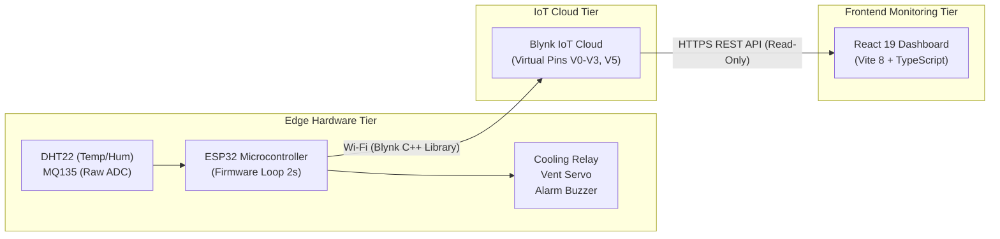

# Smart Food Storage Monitoring Dashboard

An industrial-grade IoT frontend monitoring application designed for real-time environmental monitoring, automated spoilage risk analysis, and autonomous climate control supervision in food preservation chambers.

Interfaces directly with an **ESP32 edge microcontroller node** via the **Blynk IoT Cloud Platform** to stream telemetry, evaluate multi-parameter risk models, and supervise automated equipment.

---

## 1. Project Introduction

### The Problem
Food preservation environments—including cold storage units, grain silos, pantry chambers, and commercial refrigerators—require strict climate stability. Elevated temperatures, excessive humidity, and the accumulation of volatile organic gases produced by early microbial activity accelerate food spoilage. Without continuous telemetry and automated intervention, spoilage often goes undetected until significant inventory loss occurs.

### The Solution
The **Smart Food Storage Monitoring Dashboard** addresses this challenge by providing facility operators with:
- Continuous real-time visibility into microclimate parameters.
- Multi-factor risk computation combining thermal, moisture, and spoilage gas indicators.
- Real-time tracking of autonomous edge actuators (exhaust relay, damper servo, audible alarm).
- Diagnostic health monitoring of the physical ESP32 device and its cloud datastreams.

### Target Users
- Food facility managers and warehouse supervisors.
- Industrial IoT and edge computing engineers.
- Quality assurance and cold-chain compliance auditors.

---

## 2. System Architecture

The monitoring system consists of three interconnected architectural tiers:



### Component Roles:
1. **ESP32 Edge Node**: Samples environmental sensors every 2 seconds, calculates the composite spoilage risk score on-device, commands actuators autonomously, displays local readings on an I2C LCD, and transmits datastreams to Blynk Cloud.
2. **Blynk Cloud Platform**: Acts as the cloud intermediary, providing virtual datastream routing, device connection status (`isHardwareConnected`), and external REST API endpoints.
3. **React Dashboard**: Ingests datastreams via read-only HTTP GET requests, presents real-time telemetry, visualizes trends with Recharts, and provides mock fallback simulation when hardware is offline.

---

## 3. Dashboard Features & Views

The dashboard provides six dedicated views:

| Page View | Key Capabilities |
|---|---|
| **1. Overview** | Executive summary of chamber preservation status, high-level condition badge (`SAFE`, `MODERATE`, `DANGER!`), four primary metric summary cards, 24-hour environmental trend graphs, and recent activity log. |
| **2. Live Monitoring** | High-precision sensor telemetry stream displaying individual metric cards with status badges for Temperature (°C), Relative Humidity (% RH), and MQ135 Spoilage Gas (ADC), complemented by configurable 1h / 6h / 24h historical charts. |
| **3. Risk Analytics** | Comprehensive breakdown of the composite spoilage risk index, displaying individual parameter contributions (temperature, moisture, gas), risk category gauges, and mathematical formula explanations. |
| **4. Equipment Status & Automatic Operation** | Supervision of automated chamber equipment: cooling fan relay commanded state, ventilation damper servo angle (`0°`, `60°`, `90°`), buzzer alarm state, and open-loop status disclosures. |
| **5. Alerts** | Centralized condition alerts console tracking environmental threshold crossings, critical hazard alarms, and system event history. |
| **6. Device Information** | Microcontroller hardware specifications (ESP32 architecture), Blynk Cloud connection status, and complete virtual pin mapping documentation. |

---

## 4. Sensor & Virtual Pin Mapping

The dashboard interfaces with the ESP32 firmware through the following virtual pin allocation:

| Virtual Pin | Datastream Name | Data Type | Physical Sensor / Origin | Value Range / Units | Description |
|---|---|---|---|---|---|
| **V0** | Temperature | Double | DHT22 Digital Sensor | -40.0 to +80.0 °C | Ambient chamber temperature. |
| **V1** | Humidity | Double | DHT22 Digital Sensor | 0.0 to 100.0 % RH | Ambient relative humidity percentage. |
| **V2** | Spoilage Gas | Integer | MQ135 Analog Transducer | 0 to 4095 ADC counts | Raw 12-bit ADC voltage reading. |
| **V3** | Condition Status | String | Firmware Evaluator | `SAFE` / `MODERATE` / `DANGER!` | Discrete storage condition classification. |
| **V4** | Actuator Input | Integer | None (Reserved) | 0 / 1 (Not Implemented) | Not implemented in firmware (no remote override). |
| **V5** | Firmware Risk Score | Double | On-Device Risk Formula | 0.0 to 100.0 | Primary live risk score published by edge node. |

> [!IMPORTANT]
> **MQ135 Gas Readings are Raw ADC Counts**:
> Virtual Pin V2 streams raw 12-bit analog-to-digital converter (ADC) counts (0–4095) directly from the sensor pin. The MQ135 is an uncalibrated analog sensor; **readings must not be labeled or interpreted as parts-per-million (ppm)**.

---

## 5. Risk Calculation Model

The ESP32 firmware executes the following mathematical model to evaluate chamber risk:

$$\text{Temperature Contribution} = \max\bigl(0,\,(T - 25) \times 2.0\bigr)$$

$$\text{Humidity Contribution} = \max\bigl(0,\,(H - 60) \times 1.5\bigr)$$

$$\text{Gas Contribution} = \max\bigl(0,\,(G - 1500) \times 0.02\bigr)$$

$$\text{Composite Risk Score} = \min\bigl(100.0,\,\text{Temp Contribution} + \text{Humidity Contribution} + \text{Gas Contribution}\bigr)$$

### Classification Thresholds:
- **SAFE** ($\text{Risk} \le 30.0$): Chamber conditions are optimal; preservation parameters are normal.
- **MODERATE** ($30.0 < \text{Risk} \le 60.0$): Spoilage risk factors elevated; automated mitigation active.
- **DANGER** ($\text{Risk} > 60.0$): Critical preservation hazard; high spoilage probability.

> [!NOTE]
> **Virtual Pin V5** is the primary source of truth for the live risk score. The dashboard computes an auxiliary local score via `riskCalculator.ts` strictly as an internal consistency cross-check.

---

## 6. Equipment Behavior & Autonomous Operation

The ESP32 edge microcontroller autonomously commands physical actuators based on the evaluated risk level:

| Condition Status | Risk Score Range | Cooling Relay (Fan) | Vent Servo Position | Buzzer Alarm State |
|---|---|---|---|---|
| **SAFE** | $\le 30.0$ | `LOW` (OFF) | `0°` (Closed) | Silent (OFF) |
| **MODERATE** | $> 30.0$ and $\le 60.0$ | `HIGH` (ON) | `60°` (Partial Vent) | Silent (OFF) |
| **DANGER!** | $> 60.0$ | `HIGH` (ON) | `90°` (Full Vent) | Active (Pulsing every 300 ms) |

> [!WARNING]
> **Open-Loop Hardware Actuation**:
> Actuator states shown on the dashboard represent **firmware output commands**, not physically verified actuator feedback. The hardware does not include limit switches or current sensors to confirm mechanical motion.

---

## 7. Technology Stack

- **Core Framework**: React 19 (`react`, `react-dom`)
- **Language**: TypeScript 7 (`typescript`, strict mode)
- **Bundler & Dev Server**: Vite 8 (`vite`, `@vitejs/plugin-react`)
- **Styling**: Tailwind CSS v4 (`tailwindcss`, `@tailwindcss/vite`)
- **Visualizations**: Recharts (`recharts`)
- **Iconography**: Lucide React (`lucide-react`)
- **Linter**: Oxlint (`oxlint`)
- **IoT Integration**: Blynk IoT Cloud REST API

---

## 8. Installation & Setup

### Prerequisites
- [Node.js](https://nodejs.org/) (version 20 LTS or higher recommended)
- [npm](https://www.npmjs.com/) (version 10 or higher)
- Modern web browser (Chrome, Firefox, Safari, Edge)

### 1. Clone the Repository
```bash
git clone https://github.com/your-username/smart-food-storage-dashboard.git
cd smart-food-storage-dashboard
```

### 2. Install Dependencies
```bash
npm install
```

### 3. Configure Environment Variables
Copy the configuration template to `.env.local`:

**PowerShell (Windows)**:
```powershell
Copy-Item .env.example .env.local
```

**Bash / macOS / Linux**:
```bash
cp .env.example .env.local
```

Open `.env.local` and add your Blynk device authentication token. If left blank or unset, the dashboard automatically starts in **Demonstration Mode** with simulated telemetry.

### 4. Run the Development Server
```bash
npm run dev
```
Open `http://localhost:5173` in your browser.

### 5. Run Linter
```bash
npm run lint
```

### 6. Build for Production
```bash
npm run build
```
The compiled output is emitted to `dist/`.

---

## 9. Environment Configuration

The application recognizes the following environment variables:

| Variable | Required? | Default | Description |
|---|---|---|---|
| `VITE_BLYNK_SERVER` | Optional | `blynk.cloud` | Regional Blynk API server (e.g. `fra1.blynk.cloud`, `lon1.blynk.cloud`). |
| `VITE_BLYNK_AUTH_TOKEN` | Optional | `""` (Empty) | Blynk device auth token (32 chars). When omitted, dashboard runs in demo mode. |

> [!CAUTION]
> **Client-Side Credential Exposure Notice**:
> In Vite, all variables prefixed with `VITE_` are statically bundled into client-side JavaScript. Anyone inspecting browser DevTools can view `VITE_BLYNK_AUTH_TOKEN`. Never use production master tokens in public deployments without a backend proxy.

---

## 10. Technical Limitations & Disclosures

1. **Blynk Cloud Dependency**: Live telemetry ingestion requires uninterrupted internet connectivity to Blynk Cloud.
2. **Missing Virtual Pin V5**: If datastream V5 is not created in the Blynk Console template, live firmware risk cannot be read; the dashboard displays an explicit diagnostic notice.
3. **Uncalibrated Gas Sensor**: The MQ135 provides relative analog voltage trends (0–4095 ADC counts) and is not calibrated to gas concentrations (ppm).
4. **Open-Loop Actuation**: Actuator positions are firmware-commanded states; physical feedback (limit switch or current sensor) is unavailable in current hardware.
5. **Sensor Diagnostic Limitations**: A DHT22 sensor read failure halts telemetry transmission at the edge but cannot be directly identified as a discrete fault code via the virtual pin mapping.
6. **External Notifications**: Push notifications or alert emails require explicit setup within Blynk Console Event Automations.
7. **Frontend Authentication**: Browser-direct REST queries are intended for private evaluation. Production deployments require a server-side proxy to protect credentials.

---

## 11. Screenshots

UI captures can be placed in the `screenshots/` directory (see [`screenshots/README.md`](screenshots/README.md) for naming guidelines).

| View | Screenshot Placeholder |
|---|---|
| **Overview Dashboard** |  *(Add image after running application)* |
| **Live Telemetry Stream** |  *(Add image after running application)* |
| **Risk Analytics & Model** |  *(Add image after running application)* |
| **Equipment & Actuators** |  *(Add image after running application)* |

---

## 12. Project Implementation Status

| Milestone / Subsystem | Status | Verification Details |
|---|---|---|
| **Frontend UI (6 Pages)** | **Completed** | Full React 19 light-themed interface, navigation, charts, and metric cards verified. |
| **Blynk Cloud Integration** | **Completed** | Read-only REST datastream connector implemented for V0–V3 and V5 with request deduplication and caching. |
| **Hardware Integration** | **Edge Firmware Operational** | C++ firmware programmed (`Smart_Food_Storage_Monitoring_device_fimware.ino`); physical bench validation pending. |
| **Automated Test Suite** | **Not Implemented** | No unit test runner (Vitest/Jest) configured in `package.json`; manual validation and boundary matrices documented. |
| **Production Deployment** | **Staging Ready** | Ready for private staging evaluation; backend proxy recommended before public deployment. |

---

## 13. Additional Documentation

Detailed architectural and engineering guides are available in the [`docs/`](docs/) directory:

- [System Architecture](docs/ARCHITECTURE.md)
- [Firmware Integration & Pin Mapping](docs/FIRMWARE_INTEGRATION.md)
- [Testing & Quality Assurance Guide](docs/TESTING.md)
- [Deployment & Security Guide](docs/DEPLOYMENT.md)
- [Contributing Guidelines](docs/CONTRIBUTING.md)
