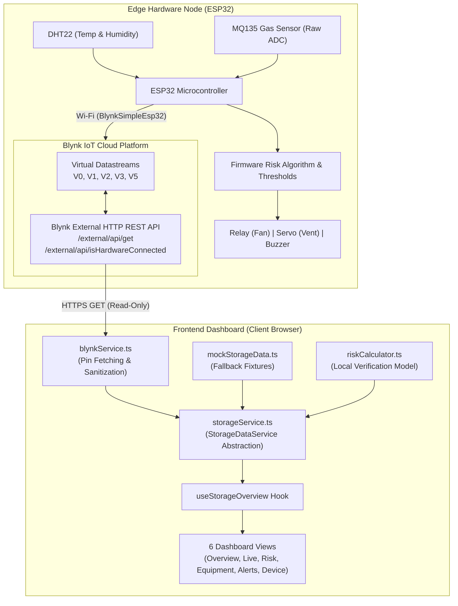

# System Architecture & Application Design

## 1. Architectural Overview

The **Smart Food Storage Monitoring Dashboard** is a client-side industrial IoT web application built with **React 19**, **TypeScript**, **Vite 8**, and **Tailwind CSS v4**. It interfaces with an **ESP32** microcontroller edge device through the **Blynk Cloud REST API**.

The application operates in two distinct operational modes:
1. **Live Read-Only Ingestion Mode**: Active when `VITE_BLYNK_AUTH_TOKEN` is configured. Connects directly to the Blynk Cloud HTTP REST API to poll telemetry datastreams published by the ESP32 firmware.
2. **Demonstration / Mock Mode**: Active by default when no Blynk token is provided. Serves centralized mock telemetry fixtures allowing full UI evaluation, responsive layout testing, and design verification without hardware.



---

## 2. Directory Structure and Component Organization

The codebase follows a modular, feature-oriented structure that isolates API communication, data models, business calculation rules, and presentation layers:

```
src/
├── assets/                     # Graphical assets, SVG brand icons
├── components/                 # Presentation and composite UI components
│   ├── analytics/              # Risk evaluation, breakdown cards, formula guide
│   ├── charts/                 # Recharts line graphs and time-series plots
│   ├── common/                 # Reusable atomic UI (badges, indicators, placeholders)
│   ├── controls/               # Actuator cards (fan relay, servo, buzzer, summary)
│   ├── dashboard/              # Top-level metric grids and chamber status blocks
│   ├── layout/                 # Application shell (AppHeader, AppSidebar, Nav config)
│   └── monitoring/             # Live gauges and telemetry cards
├── data/                       # Centralized mock telemetry fixtures (mockStorageData.ts)
├── hooks/                      # Custom hooks for state orchestration (useStorageOverview.ts)
├── pages/                      # Page-level route views (6 primary dashboards)
│   ├── AlertsPage.tsx
│   ├── DeviceInfoPage.tsx
│   ├── EquipmentControlPage.tsx
│   ├── LiveMonitoringPage.tsx
│   ├── OverviewPage.tsx
│   └── RiskAnalyticsPage.tsx
├── services/                   # Data service layer and external API integration
│   ├── blynkService.ts         # Low-level Blynk HTTP client and pin parsers
│   └── storageService.ts       # Unified StorageDataService interface and caching
├── styles/                     # Tailwind CSS entry stylesheets (index.css)
├── types/                      # Comprehensive TypeScript domain models (storage.ts, navigation.ts)
├── utils/                      # Mathematical models and classification rules (riskCalculator.ts)
├── App.tsx                     # Application shell and top-level tab navigation
├── main.tsx                    # React 19 root mount point
└── vite-env.d.ts               # Vite environment type declarations
```

---

## 3. Data Flow and Ingestion Pipeline

### Telemetry Ingestion Flow

1. **Trigger**: Dashboard pages poll or refresh state on component mount, user manual click, or polling intervals via custom hooks (`useStorageOverview`) or page-level lifecycle effects.
2. **Service Resolution**:
   - `storageService` queries `getBlynkConfig()`.
   - If `token` is non-empty, requests are directed to `BlynkStorageService`.
   - If `token` is blank, requests resolve to `MockStorageService`.
3. **Datastream Ingestion**:
   - `testPinConnection(pin)` queries Blynk Cloud:
     `GET https://{server}/external/api/get?token={token}&{pin}`
   - Parallel fetching queries `V0`, `V1`, `V2`, `V3`, and `V5`.
   - Hardware connection state is checked via `/external/api/isHardwareConnected`.
4. **Validation and Parsing**:
   - Values are parsed and validated strictly against hardware specifications:
     - `V0`: finite float (°C).
     - `V1`: finite float (0–100 % RH).
     - `V2`: integer (0–4095 ADC counts; uncalibrated raw voltage).
     - `V3`: exact string (`SAFE`, `MODERATE`, `DANGER!`); numeric codes are rejected.
     - `V5`: finite float (0–100 risk score).
5. **State Aggregation**:
   - `getDashboardSnapshot()` compiles `StorageDashboardSnapshot`.
   - In-memory caching prevents redundant network bursts.

---

## 4. Blynk Service Architecture

`src/services/blynkService.ts` isolates all low-level HTTP interaction with Blynk Cloud:

- **Target Endpoints**:
  - `GET https://{server}/external/api/get?token={token}&{pin}`
  - `GET https://{server}/external/api/isHardwareConnected?token={token}`
- **Security Redaction**:
  - URLs logged or returned in error traces are scrubbed using `sanitizeLogUrl()` to strip auth tokens (`token=[REDACTED]`).
- **Request Deduplication & Caching**:
  - In-flight requests for the same pin are consolidated using a promise map (`inFlightPinRequests`).
  - Fetched values are cached for 1,500 ms (`PIN_CACHE_TTL_MS`) to respect rate-limiting.
  - Hardware connectivity is cached for 2,000 ms (`HW_CONNECTED_CACHE_TTL_MS`).
- **Timeout Protection**:
  - All network fetches use `AbortController` with an 8,000 ms timeout (`DEFAULT_TIMEOUT_MS`).

---

## 5. State Management & Data Freshness

State is managed through standard React hooks (`useState`, `useEffect`, `useCallback`) coupled with the `useStorageOverview` custom hook:

- **Data Source Transparency**:
  - Every telemetry payload carries `isMock: boolean` and `dataSource: 'mock' | 'blynk_live'`.
  - The UI explicitly renders connection pills and badges to inform users whether live data is being shown or simulated demonstration data is active.
- **Data Freshness and Timestamps**:
  - Telemetry payloads include ISO 8601 UTC timestamps indicating when the edge node or service evaluated the reading.
  - Snapshot caching retains data for 2,500 ms in `BlynkStorageService` to prevent UI thrashing during rapid view switching.
  - Stale indicators (`isStale?: boolean`) surface when cached values are displayed following a transient fetch failure.

---

## 6. Error Handling & Resilience Patterns

The service layer implements tiered error handling to maintain uninterrupted UI operation:

| Failure Mode | Service Response | UI Presentation |
|---|---|---|
| **Missing Blynk Token** | `isLive()` returns `false`. Transparently falls back to `MockStorageService`. | Amber "Demonstration Mode" badge in header. |
| **Blynk Cloud Offline / Network Error** | `fetchPinRaw` catches network/CORS error; returns `isCorsError: true`. | Connection indicator displays "Offline / Unreachable"; error card offers "Retry". |
| **Virtual Pin V5 Unconfigured** | Detects HTTP 400 or `"doesn't exist"` response. Sets `v5Status: 'unconfigured'`, `score: null`. | Shows "Datastream V5 Unconfigured in Blynk Console" banner; does **not** silently overwrite with local calculation. |
| **Malformed Pin V3 Data (Numeric '1' / '0')** | `parseStorageCondition` throws explicit descriptive error. | Status displays `UNAVAILABLE`; warns operator of unexpected firmware output. |
| **Request Timeout** | `AbortController` aborts after 8s; returns descriptive timeout error. | Displays timeout notification with manual retry control. |
